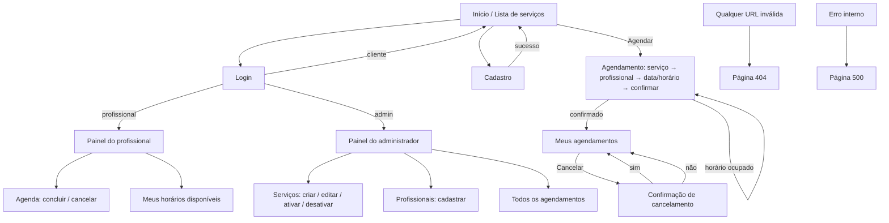

# IHC — Interface Humano-Computador do AgendaFácil

## 1. Princípios aplicados (conforme o material da disciplina)

| Princípio | Como foi aplicado |
|---|---|
| **Clareza** | Preço e duração sempre visíveis no card do serviço; rótulos em linguagem do dia a dia ("Meus agendamentos", "Horários livres"); datas no formato brasileiro (dd/mm/aaaa). |
| **Consistência** | Mesmo cabeçalho, mesmo estilo de botão em todas as telas: azul = ação principal, contorno = secundária, vermelho = destrutiva. Mensagens sempre no topo do conteúdo. |
| **Simplicidade** | Agendamento em 4 passos com divulgação progressiva: só aparece o próximo campo quando o anterior foi escolhido. O menu mostra apenas o que o papel do usuário pode fazer. |
| **Controle do usuário** | Nenhuma ação é feita sem clique do usuário. Cancelamento pede confirmação. Em qualquer passo do agendamento é possível "trocar" o serviço ou o profissional. |
| **Ação direta** | O horário escolhido fica destacado (causa e efeito visível); ao confirmar, o usuário vê o agendamento na lista com a mensagem de sucesso. |
| **Recuperação de erros** | Erros de formulário preservam o que foi digitado; horário ocupado devolve o usuário à escolha de horário com a lista atualizada; páginas 404/500 oferecem link para voltar ao início. |
| **Feedback imediato** | Validação no navegador (HTML5 + JS) antes do envio; mensagens flash de sucesso/erro após cada ação; botão de envio mostra "Enviando..." e fica desabilitado para evitar clique duplo. |
| **Estética agradável** | Paleta neutra com uma cor de destaque, tipografia do sistema, bom contraste (WCAG AA) e espaçamento generoso. |

## 2. Mapa de telas (navegação)

## 3. Wireframes

Os wireframes de baixa fidelidade estão em [`wireframes/`](wireframes/index.html) (HTML + CSS simples, abrem em qualquer navegador). Há imagens deles em `wireframes/png/`. O mapa de telas exportado está em [`ihc-mapa-telas.png`](ihc-mapa-telas.png).

| # | Tela | Arquivo | Atores |
|---|---|---|---|
| 1 | Login | [01-login.html](wireframes/01-login.html) | Todos |
| 2 | Cadastro | [02-cadastro.html](wireframes/02-cadastro.html) | Cliente |
| 3 | Lista de serviços | [03-servicos.html](wireframes/03-servicos.html) | Todos |
| 4 | Agendamento | [04-agendar.html](wireframes/04-agendar.html) | Cliente |
| 5 | Meus agendamentos + cancelamento | [05-meus-agendamentos.html](wireframes/05-meus-agendamentos.html) | Cliente |
| 6 | Painel do profissional | [06-painel-profissional.html](wireframes/06-painel-profissional.html) | Profissional |
| 7 | Painel do administrador | [07-painel-admin.html](wireframes/07-painel-admin.html) | Administrador |

As telas finais implementadas estão capturadas em `docs/evidencias/` (geradas automaticamente com Playwright).

## 4. Mensagens do sistema

### 4.1 Sucesso (verde, ícone ✔)

| Código | Situação | Mensagem |
|---|---|---|
| MS01 | Cadastro realizado | "Conta criada com sucesso! Bem-vindo(a), {nome}." |
| MS02 | Login | "Olá, {nome}!" |
| MS03 | Logout | "Você saiu da sua conta." |
| MS04 | Agendamento criado | "Agendamento confirmado: {serviço} com {profissional} em {dd/mm/aaaa} às {hh:mm}." |
| MS05 | Cancelamento | "Agendamento cancelado. O horário foi liberado." |
| MS06 | Atendimento concluído | "Atendimento marcado como concluído." |
| MS07 | Serviço salvo | "Serviço salvo com sucesso." |
| MS08 | Profissional cadastrado | "Profissional {nome} cadastrado." |
| MS09 | Horário de trabalho adicionado/removido | "Horário adicionado." / "Horário removido." |

### 4.2 Erro (vermelho, ícone ✖) e aviso (amarelo, ícone ⚠)

| Código | Situação | Mensagem |
|---|---|---|
| ME01 | Login inválido | "E-mail ou senha incorretos." (genérica, por segurança) |
| ME02 | E-mail duplicado | "Este e-mail já está cadastrado. Faça login ou use outro e-mail." |
| ME03 | Campo obrigatório | "Preencha o campo {campo}." |
| ME04 | Senha fraca / não confere | "A senha deve ter pelo menos 8 caracteres." / "As senhas não conferem." |
| ME05 | Horário ocupado | "Este horário acabou de ser ocupado. Escolha outro horário." |
| ME06 | Horário no passado | "Não é possível agendar em um horário que já passou." |
| ME07 | Fora da jornada | "O profissional não atende nesse horário." |
| ME08 | Cancelamento tardio | "Cancelamento só é permitido com pelo menos 2 horas de antecedência. Entre em contato com o salão." |
| ME09 | Acesso negado | "Você não tem permissão para acessar esta página." |
| ME10 | Sessão necessária | "Faça login para continuar." (aviso) |
| ME11 | Preço/duração inválidos | "O preço deve ser maior que zero." / "A duração deve estar entre 5 e 480 minutos." |
| ME12 | Formulário expirado (CSRF) | "Sua sessão expirou. Recarregue a página e tente novamente." |
| ME13 | 404 | "Página não encontrada. Ela pode ter sido removida ou o endereço está incorreto." |
| ME14 | 500 | "Algo deu errado do nosso lado. Já registramos o problema; tente novamente em instantes." |

## 5. Como o sistema dá feedback ao usuário

1. **Antes do envio (cliente):** atributos HTML5 (`required`, `type=email`, `min`, `minlength`) e um script (`static/js/app.js`) que valida a confirmação de senha em tempo real e destaca o campo inválido.
2. **No envio:** o botão muda para "Enviando..." e é desabilitado (evita agendamento duplicado por clique duplo).
3. **Depois do envio (servidor):** a validação é refeita no servidor; os erros voltam como mensagens flash no topo e o formulário mantém os valores digitados.
4. **Estado do sistema:** o item de menu da página atual fica destacado; o status de cada agendamento aparece como um selo colorido (Agendado / Cancelado / Concluído); o motivo de um botão "Cancelar" estar indisponível é explicado ("menos de 2h").
5. **Ações destrutivas:** pedem confirmação com o resumo do que será afetado.
6. **Erros inesperados:** página 500 amigável, a transação é desfeita (rollback) e o erro é registrado no log do servidor.
7. **Acessibilidade:** mensagens flash usam `role="alert"`, os campos têm `<label>` associado, há foco visível e navegação por teclado.
