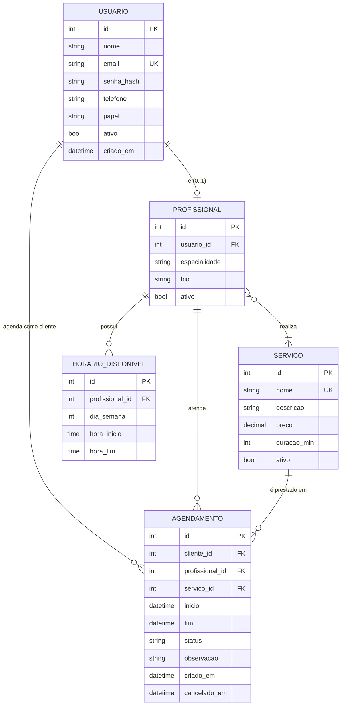

# Modelo conceitual (DER)

Derivado do diagrama de classes de persistência (`../uml/classes.md`). Notação "pé de galinha" (crow's foot).

## Cardinalidades explicadas

| Relacionamento | Cardinalidade | Leitura |
|---|---|---|
| Usuário — Profissional | 1 : 0..1 | Todo profissional é exatamente um usuário; um usuário pode ou não ser profissional (clientes e admins não são). |
| Usuário (cliente) — Agendamento | 1 : 0..N | Um cliente pode ter vários agendamentos; cada agendamento pertence a exatamente um cliente. |
| Profissional — Agendamento | 1 : 0..N | Um profissional atende vários agendamentos; cada agendamento tem exatamente um profissional. |
| Serviço — Agendamento | 1 : 0..N | Um serviço aparece em vários agendamentos; cada agendamento é de exatamente um serviço. |
| Profissional — HorárioDisponível | 1 : 0..N | Um profissional tem várias faixas de horário na semana; cada faixa pertence a um profissional (dependência de existência). |
| Profissional — Serviço | N : N (0..N : 1..N) | Um profissional realiza um ou mais serviços; um serviço pode ser realizado por vários profissionais. Resolvido pela tabela associativa `profissional_servico`. |
