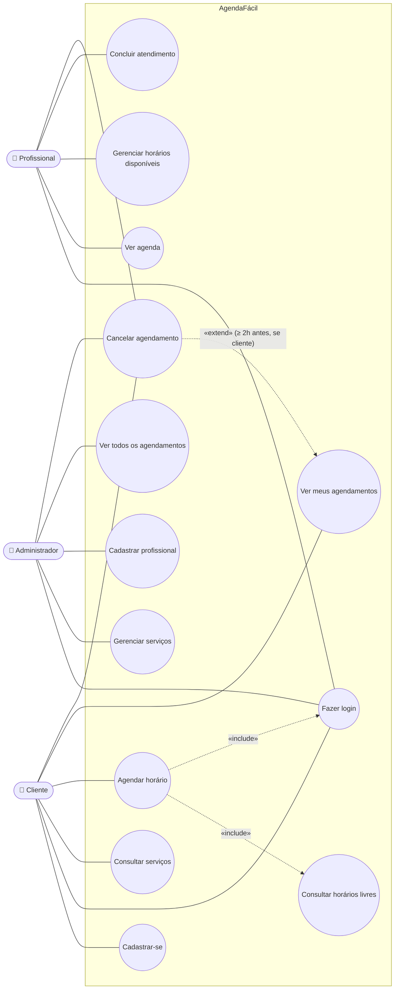

# Diagrama de casos de uso

O Mermaid não tem um tipo nativo de "casos de uso"; usamos um `flowchart` com atores (retângulos arredondados) e casos de uso (elipses), mantendo a semântica UML (associações, «include» e «extend»).

## Descrição resumida dos casos de uso

| ID | Caso de uso | Ator(es) | Pré-condição | Pós-condição |
|---|---|---|---|---|
| UC01 | Cadastrar-se | Cliente | E-mail ainda não cadastrado | Usuário com papel `cliente` criado |
| UC02 | Fazer login | Todos | Usuário cadastrado e ativo | Sessão autenticada |
| UC03 | Consultar serviços | Todos | — | Lista de serviços ativos exibida |
| UC04 | Agendar horário | Cliente | Logado; serviço e profissional ativos | Agendamento `agendado` criado |
| UC05 | Consultar horários livres | Cliente | Serviço, profissional e data escolhidos | Lista de horários livres exibida |
| UC06 | Ver meus agendamentos | Cliente | Logado | Lista exibida |
| UC07 | Cancelar agendamento | Cliente, Profissional, Admin | Agendamento `agendado`; cliente: ≥ 2h de antecedência | Status `cancelado`; horário liberado |
| UC08 | Ver agenda | Profissional | Logado como profissional | Agenda exibida |
| UC09 | Gerenciar horários disponíveis | Profissional | Logado como profissional | Jornada atualizada |
| UC10 | Concluir atendimento | Profissional | Agendamento `agendado` já iniciado | Status `concluido` |
| UC11 | Gerenciar serviços | Admin | Logado como admin | Serviço criado/alterado/ativado/desativado |
| UC12 | Cadastrar profissional | Admin | E-mail não cadastrado | Usuário `profissional` + Profissional criados |
| UC13 | Ver todos os agendamentos | Admin | Logado como admin | Lista exibida |
