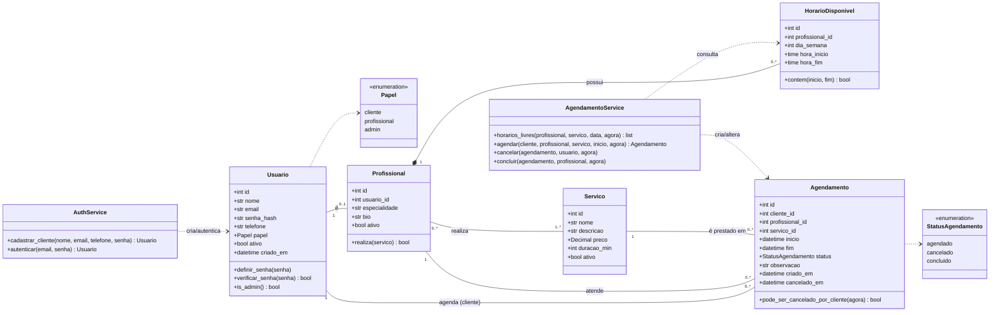

# Diagrama de classes (persistência e serviços)

**Notas:**

- `Profissional` é uma especialização por associação 1:1 com `Usuario` (o login é sempre um `Usuario`; os dados de trabalho ficam em `Profissional`). Essa escolha evita colunas nulas na tabela de usuários para clientes.
- `HorarioDisponivel` é composição de `Profissional`: se o profissional for removido, sua jornada também é.
- A associação N:N `Profissional`–`Servico` vira a tabela `profissional_servico` no modelo lógico.
