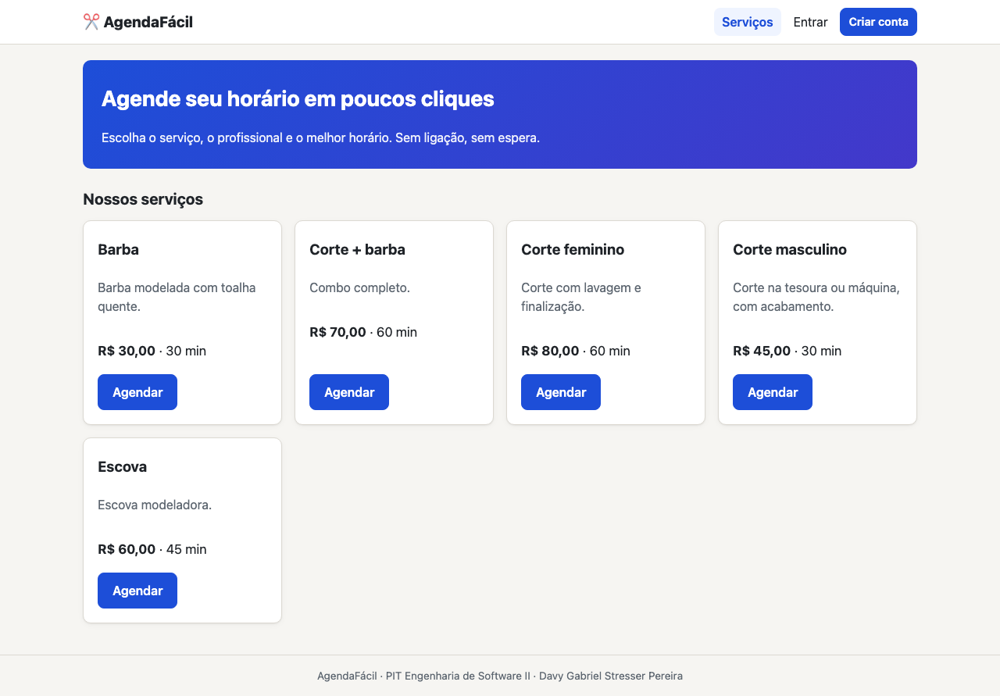

# Laudo de qualidade — AgendaFácil

**Versão avaliada:** 1.0.0 · **Responsável:** Davy Gabriel Stresser Pereira (RGM 36963089) · **Emissão:** 19/10/2026 (parcial: aguardando os testes dos colegas)

## 1. Resumo

| Indicador | Valor |
|---|---|
| Casos de teste automatizados | 87 executados, 87 aprovados ([relatório](../situacao-2/relatorio-testes.md)) |
| Cobertura de código | 97% |
| Casos de teste do plano (CT-01 a CT-37) | 37 aprovados ([plano](plano-testes.md)) |
| Defeitos encontrados na verificação interna | 4 (todos corrigidos), seção 3 |
| Testes de aceitação com colegas | 0 de 5 realizados, seção 4 [PENDENTE: aguardando teste real] |
| Defeitos encontrados pelos colegas | [PENDENTE: aguardando teste real] |

**Escala de severidade**

| Severidade | Critério |
|---|---|
| Crítica | Impede o uso do sistema ou corrompe dados (ex.: dois clientes no mesmo horário). |
| Alta | Uma funcionalidade principal não funciona e não há alternativa. |
| Média | A funcionalidade funciona com falhas ou há alternativa. |
| Baixa | Problema visual, de texto ou de conforto de uso. |

## 2. Evidências das funcionalidades (versão 1.0.0)

Prints gerados automaticamente com Playwright (`python scripts/gerar_evidencias.py`), em `docs/evidencias/`:

| Funcionalidade | Evidência |
|---|---|
| Lista de serviços |  |
| Login e erro de login | [02-login.png](../evidencias/02-login.png) · [03-login-erro.png](../evidencias/03-login-erro.png) |
| Validação no cliente (senhas diferentes) | [04-cadastro-validacao-cliente.png](../evidencias/04-cadastro-validacao-cliente.png) |
| Validação no servidor (e-mail duplicado) | [05-cadastro-email-duplicado.png](../evidencias/05-cadastro-email-duplicado.png) |
| Agendamento em passos | [06](../evidencias/06-agendar-passo1-servico.png) · [07](../evidencias/07-agendar-passo2-profissional.png) · [08](../evidencias/08-agendar-passo3-horarios.png) |
| Agendamento confirmado | [09-agendamento-confirmado.png](../evidencias/09-agendamento-confirmado.png) |
| Confirmação e cancelamento | [10-cancelar-confirmacao.png](../evidencias/10-cancelar-confirmacao.png) · [11-agendamento-cancelado.png](../evidencias/11-agendamento-cancelado.png) |
| Horário ocupado (dois clientes) | [12-horario-ocupado.png](../evidencias/12-horario-ocupado.png) |
| Erros 404 e 403 | [13-pagina-404.png](../evidencias/13-pagina-404.png) · [14-acesso-negado-403.png](../evidencias/14-acesso-negado-403.png) |
| Painel do profissional | [15-painel-profissional.png](../evidencias/15-painel-profissional.png) |
| Painel do administrador | [16-painel-admin.png](../evidencias/16-painel-admin.png) · [17-admin-servico-invalido.png](../evidencias/17-admin-servico-invalido.png) · [18-admin-profissionais.png](../evidencias/18-admin-profissionais.png) · [19-admin-agendamentos.png](../evidencias/19-admin-agendamentos.png) |
| Responsivo (celular) | [20-mobile-servicos.png](../evidencias/20-mobile-servicos.png) · [21-mobile-meus-agendamentos.png](../evidencias/21-mobile-meus-agendamentos.png) · [22-mobile-menu.png](../evidencias/22-mobile-menu.png) |

## 3. Defeitos encontrados na verificação interna (desenvolvedor)

Defeitos reais encontrados por mim durante a verificação (revisões, `flask db check`, execução do DDL e testes automatizados), antes da entrega aos colegas.

| ID | Descrição | Evidência | Severidade | Correção aplicada | Status |
|---|---|---|---|---|---|
| D-01 | O DDL dependia da extensão `btree_gist` para a restrição `EXCLUDE`. Num PostgreSQL sem essa extensão o script falhava na primeira linha e nenhuma tabela era criada. | Saída do `psql`: `ERROR: extension "btree_gist" is not available` (VR-02 do plano de testes) | Alta | A restrição passou a usar `int4range(profissional_id, profissional_id, '[]') WITH =`, que é nativo do GiST. A extensão deixou de ser necessária no DDL e na migração. | Corrigido e verificado (CT-21) |
| D-02 | Os nomes de 2 índices nos models (`ix_agendamentos_servico_id`, `ix_profissional_servico_servico_id`) divergiam do DDL (`ix_ag_servico`, `ix_ps_servico`); uma futura `flask db migrate` geraria uma migração indevida. | Saída do `flask db check`: `New upgrade operations detected` (VR-01) | Média | Índices declarados explicitamente nos models com os nomes do DDL. | Corrigido: `No new upgrade operations detected.` |
| D-03 | No diagrama de casos de uso exportado em PNG, os rótulos `<<include>>` e `<<extend>>` apareciam como `<>`, porque o texto era tratado como tag HTML. | `docs/situacao-1/uml/casos-de-uso.png` (versão anterior) | Baixa | Rótulos trocados por guillemets («include», «extend») e PNG regenerado. | Corrigido |
| D-04 | Teste E2E de cancelamento falhava: o seletor do card "Barba" também casava com "Corte + barba" (strict mode do Playwright). Era defeito do teste, não do sistema. | Saída do pytest: `strict mode violation ... resolved to 2 elements` | Baixa | O seletor passou a casar o título exato do card. | Corrigido: 3/3 E2E aprovados |

## 4. Testes de aceitação com colegas

> Cada colega seguiu o roteiro do [formulário](formulario-colegas.md). Os prints enviados ficam em `docs/evidencias/colegas/`.

### 4.1 Colega 1

| Campo | Resposta |
|---|---|
| Nome | [PENDENTE: aguardando teste real] |
| Data do teste | [PENDENTE: aguardando teste real] |
| O que testou e funcionou | [PENDENTE: aguardando teste real] |
| O que testou e não funcionou, e o que deve ser corrigido | [PENDENTE: aguardando teste real] |
| Funcionalidade não testada, e por quê | [PENDENTE: aguardando teste real] |
| Evidências (prints) | [PENDENTE: aguardando teste real] |

### 4.2 Colega 2

| Campo | Resposta |
|---|---|
| Nome | [PENDENTE: aguardando teste real] |
| Data do teste | [PENDENTE: aguardando teste real] |
| O que testou e funcionou | [PENDENTE: aguardando teste real] |
| O que testou e não funcionou, e o que deve ser corrigido | [PENDENTE: aguardando teste real] |
| Funcionalidade não testada, e por quê | [PENDENTE: aguardando teste real] |
| Evidências (prints) | [PENDENTE: aguardando teste real] |

### 4.3 Colega 3

| Campo | Resposta |
|---|---|
| Nome | [PENDENTE: aguardando teste real] |
| Data do teste | [PENDENTE: aguardando teste real] |
| O que testou e funcionou | [PENDENTE: aguardando teste real] |
| O que testou e não funcionou, e o que deve ser corrigido | [PENDENTE: aguardando teste real] |
| Funcionalidade não testada, e por quê | [PENDENTE: aguardando teste real] |
| Evidências (prints) | [PENDENTE: aguardando teste real] |

### 4.4 Colega 4

| Campo | Resposta |
|---|---|
| Nome | [PENDENTE: aguardando teste real] |
| Data do teste | [PENDENTE: aguardando teste real] |
| O que testou e funcionou | [PENDENTE: aguardando teste real] |
| O que testou e não funcionou, e o que deve ser corrigido | [PENDENTE: aguardando teste real] |
| Funcionalidade não testada, e por quê | [PENDENTE: aguardando teste real] |
| Evidências (prints) | [PENDENTE: aguardando teste real] |

### 4.5 Colega 5

| Campo | Resposta |
|---|---|
| Nome | [PENDENTE: aguardando teste real] |
| Data do teste | [PENDENTE: aguardando teste real] |
| O que testou e funcionou | [PENDENTE: aguardando teste real] |
| O que testou e não funcionou, e o que deve ser corrigido | [PENDENTE: aguardando teste real] |
| Funcionalidade não testada, e por quê | [PENDENTE: aguardando teste real] |
| Evidências (prints) | [PENDENTE: aguardando teste real] |

## 5. Defeitos apontados pelos colegas

| ID | Descrição | Encontrado por | Evidência (`docs/evidencias/colegas/`) | Severidade | Correção aplicada | Status |
|---|---|---|---|---|---|---|
| C-01 | [PENDENTE: aguardando teste real] | | | | | |

> Para cada defeito: reproduzir, criar um teste automatizado que falhe, corrigir, rodar `pytest` e registrar a correção no [changelog](changelog-melhorias.md).

## 6. Parecer final

[PENDENTE: aguardando teste real. Preencher depois dos 5 testes e das correções, informando se a versão atende ao critério de aprovação do plano de testes: nenhum defeito Crítico ou Alto aberto.]
